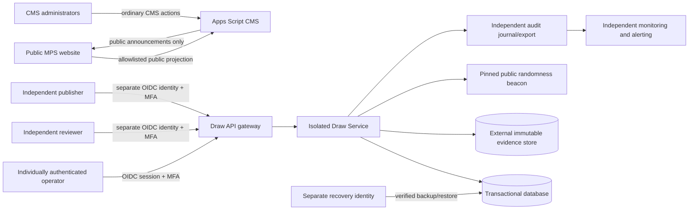

# MPS P1.21 — Security Architecture Implementation Blueprint

**Status:** Design/implementation blueprint only. Workbench branch only.  
**Decision:** NO-GO for production winner draw; roulette remains SIMULATION ONLY.  
**Predecessor:** P1.20 production activation readiness assessment.  
**Scope:** Convert the G0–G11 blockers and prior security designs into an ordered, testable implementation program. This document does not authorize provisioning, deployment, migration, or production access.

## 1. Executive decision

P1.21 defines the implementation sequence and acceptance evidence needed before any official winner draw can be enabled. The current synthetic harness and CI results are useful engineering evidence, but they are not operational evidence for identity, cloud controls, external audit provenance, retention, cryptographic beacon verification, backup recovery, alert delivery, or production authorization.

**No production gate is promoted to PASS by this blueprint.** All operational gates remain PARTIAL or NOT STARTED until independently verifiable evidence exists in the actual isolated environment and the release authority accepts it.

The implementation target is a separately authenticated, isolated Draw Service. The existing public GitHub Pages site remains a public presentation surface; the existing Apps Script remains the ordinary MPS CMS/member backend. Neither is trusted to perform privileged draw authorization or cryptographic verification.

## 2. Target architecture and trust boundaries

The diagram is a logical target, not a statement that these systems currently exist.

### 2.1 Trust zones

| Zone | Responsibility | Explicitly not trusted for |
|---|---|---|
| Public website / GitHub Pages | Public announcements, masked public projections, links | Authentication, eligibility, roster storage, draw execution |
| Apps Script CMS | Existing member/CMS workflows; public-safe announcement projection | Privileged draw identity, dual control, immutable audit, cryptographic beacon verification |
| Identity provider | Individually authenticated subjects, MFA/step-up, signed OIDC claims | Business authorization without server-side role mapping |
| Draw API gateway/service | Server-side authorization, state machine, idempotency, validation | Trusting client-supplied actor/role or relay `verified:true` |
| Transactional database | Atomic state transitions, unique constraints, durable idempotency | External tamper evidence by itself |
| Evidence store | Create-only evidence objects, exact-generation readback, retention | Authenticity of evidence merely because it is stored |
| Beacon verifier | Verify pinned chain parameters and cryptographic proof | Trusting an unverified proxy or returned boolean |
| Audit/monitoring zone | Independent logs, integrity checks, alerting | Self-reported normalized evidence without provenance |
| Recovery zone | Isolated backup, restore, key recovery | Same-identity administration of source and backup |

### 2.2 Data classification and flow

- **Private participant data:** names, member IDs, contact details, Telegram identifiers, MT5 identifiers, deposit/payment data, PINs, documents and eligibility evidence. It must never enter public projections, ticker text, logs, URLs, analytics, beacon requests or evidence-object metadata.
- **Private roster snapshot:** minimum necessary pseudonymous participant references and eligibility decisions. Encrypted at rest and in transit; access restricted to the draw service and explicitly authorized reviewers. No raw roster is published.
- **Public proof:** event/rules version, eligible count, commitment digest, beacon chain and round, selected index, verifier/protocol version, proof digest and publication status. A public commitment does not independently prove roster completeness or eligibility.
- **Operational security evidence:** identity subject references, approvals, state transitions, idempotency references, object generation, hashes and audit pointers. Avoid personal contact data and secrets.
- **Public announcement data:** strict allowlist, safe text, approved links and masked Member ID only where the approved privacy policy permits it. If masking is invalid, ambiguous or colliding, omit the ID and use generic text.

Every boundary requires schema validation, explicit allowlists, least privilege, data minimization, bounded input sizes and fail-closed behavior.

## 3. Component contracts

### C1 — Identity and privileged session

- Use a maintained OIDC provider with Authorization Code + PKCE and server-side code exchange.
- Validate signature against pinned/rotated JWKS; exact issuer, audience, authorized party, expiry, issued-at, nonce and state; reject algorithm confusion and unknown critical claims.
- Require MFA and step-up assurance for privileged approvals and execution.
- Map immutable `issuer + subject` to a server-managed operator registry. Never accept role, email, actor ID or approval identity from request bodies.
- Use short-lived server sessions, Secure/HttpOnly/SameSite cookies, CSRF protection, rotation and revocation. Do not store bearer tokens in localStorage.
- Record authenticated subject, issuer, authentication context, session reference hash, server timestamp and role-at-action in the audit event.
- If an individually authenticated identity or required MFA assurance cannot be established, privileged operations are unavailable.

### C2 — Authorization and separation of duties

- Roles: DRAW_OPERATOR, DRAW_REVIEWER, DRAW_PUBLISHER, DRAW_AUDITOR and DRAW_SECURITY_ADMIN; service identities are separate and non-interactive.
- Operator, reviewer and publisher must resolve to distinct immutable human subjects for the same draw. A single person holding several roles does not satisfy dual control.
- Reviewer approves the exact frozen rules digest and participant snapshot digest, not a mutable event label.
- Publisher approves the exact public projection digest after verification.
- Security administration cannot silently approve a draw or rewrite historical evidence.
- No second independent human subject means official draw is disabled.

### C3 — Draw API and transactional state

- Implement the P1 API contract under versioned HTTPS endpoints; deny unknown privileged fields.
- Use a transactional relational database (or an equivalently proven transactional store) with unique constraints for event/version, approval, idempotency key, operation and publication.
- Each state transition executes in one database transaction: lock/re-read current state, verify expected version and actor, write durable intent/state/outbox, commit, then read back.
- Use compare-and-swap/version preconditions. Duplicate identical requests return the recorded result; same key with different canonical payload returns conflict.
- External side effects use a transactional outbox and idempotent consumers. Never claim a notification or evidence write succeeded before provider acknowledgement and readback.
- Ambiguous outcomes transition to RECONCILIATION_REQUIRED; never silently rerun a draw or invent a successful result.

### C4 — Participant snapshot and eligibility

- Freeze the roster from an explicitly approved source and eligibility rule version.
- Define inclusion/exclusion, duplicate resolution, cutoff time/timezone, correction window, appeals and exceptional cases before the event opens.
- Canonicalize and version the snapshot; compute commitment using a reviewed scheme with a secret salt/key held outside the public artifact. Publish only the digest and minimum metadata.
- Reviewer receives a controlled review view and approves the exact snapshot digest.
- Any roster or rule change invalidates approvals and requires a new version and complete re-approval.
- Never expose participant list, raw IDs, names or reversible mapping in public proof.

### C5 — Evidence storage and provenance

- Select and provision a provider only after separate approval of project/account, billing, IAM owners, retention policy, recovery and cost ceiling.
- Use create-only conditional writes, exact object-generation reads, provider checksum plus independently computed digest, immutable receipt and independent readback.
- Writer, verifier, storage administrator, audit administrator and recovery operator must be distinct subjects and administrative boundaries.
- Enable and export required data-access/admin audit logs to an independently administered destination; prove query scope, pagination completeness and source provenance.
- Treat normalized logs and reviewer attestations as assertions until the raw source is independently retrieved and authenticated. A valid reviewer signature authenticates the reviewer statement, not Google's source log.
- Do not enable irreversible retention locks during a reversible PoC. Any retention lock requires a separate explicit governance approval and documented recovery/retention consequences.

### C6 — Cryptographic randomness and verification

- Pin the beacon chain identity, public key, genesis/period/scheme and verifier version out-of-band.
- Commit the event, rules digest, snapshot digest, algorithm version and future beacon round before that round is available.
- Verify the actual beacon signature/proof with a maintained, reviewed verifier; do not trust an intermediary's `verified:true`.
- Use a documented deterministic unbiased selection method (rejection sampling; no simple modulo bias), fixed canonical input encoding and reproducible test vectors.
- Verify the full proof independently before the draw can enter VERIFIED.
- Beacon outage, invalid signature, wrong chain, missed round, malformed proof or verifier-version drift stops the event. No reroll or alternate beacon without a pre-approved, publicly documented exceptional protocol.

### C7 — Audit journal and external anchoring

- Persist intent and completion records with stable sequence, canonical payload digest, actor subject, operation/idempotency reference, state version and timestamp.
- Read back every critical record and reconcile uncertain writes.
- Use an append-only journal plus independent external anchoring; a local hash chain alone is not tamper-proof.
- Preserve raw evidence and failed/ambiguous records. Never delete or rewrite a conflicting journal to make validation pass.
- Independent auditors must be able to verify sequence, digest, anchor receipt and state transitions without access to the private roster.

### C8 — Backup, recovery and key management

- Separate source and backup accounts/projects/regions and administrative identities.
- Define and approve RPO/RTO before activation. Require periodic restore drills to a new target, exact-generation verification, source preservation and independent checkpoint comparison.
- Document encryption-key custody, rotation, recovery, revocation, emergency access and loss scenarios. A backup without recoverable keys is not a recoverable backup.
- Retention, backup and recovery evidence must be independently read and audited.
- Restore/cutover requires two-person authorization, quiescence, evidence preservation and post-restore reconciliation.

### C9 — Monitoring, incident response and publication

- Monitor backup freshness/integrity, audit export freshness/pagination, retention expiry, key recovery, verifier health, API errors, idempotency conflicts and reconciliation backlog.
- Use stable alert keys and durable outbox delivery; mark DELIVERED only after explicit provider acknowledgement.
- Set owner-approved alert destinations, on-call coverage, escalation, severity and response objectives before activation.
- Conduct a human tabletop exercise with actual designated roles; synthetic evaluator tests alone are not operational readiness.
- Public publication is a separate approved action over a strict public projection. No private roster, member names or raw identifiers are published.
- Withdrawal/correction preserves original evidence and appends a new audited state; never silently overwrite a published result.

## 4. Ordered implementation programme and dependency graph

The sequence below is a dependency order. Durations are planning estimates for active engineering/review time after owners and prerequisites are available; they are not delivery promises and exclude procurement, waiting for approvals, provider account verification and independent review.

| Phase | Depends on | Deliverables | Exit evidence |
|---|---|---|---|
| A — Governance & ownership | None | Named accountable owner, event policy, privacy policy, budget ceiling, RPO/RTO, retention and risk acceptance | Signed decision register; distinct human owners |
| B — Identity foundation | A | OIDC tenant/config, MFA, immutable subject registry, session lifecycle, revocation | Negative/positive identity tests; independently checked provider config |
| C — Dual control | B | Server role mapping, separation rules, approval UI/API, audit actor binding | Same-subject rejection; two-human approval evidence |
| D — Transactional service | B,C | API gateway, DB schema, state machine, durable idempotency, outbox, reconciliation | Concurrent/race/restart/fault-injection tests on isolated environment |
| E — Evidence provider | A,B | Isolated project/account, IAM, conditional object writes, retention policy, audit export | Actual provider write/readback, delete-denial, raw audit provenance and independent review |
| F — Backup & recovery | D,E | Off-site backup, key recovery, restore automation/runbook | Independent restore drill with measured RPO/RTO and source preservation |
| G — Beacon and proof | C,D,E | Pinned beacon verifier, canonical encoding, unbiased selection, reproducible proof | Independent test vectors, signature/chain failures, no-bias review |
| H — Monitoring and response | B,D,E,F,G | Monitoring, durable alert delivery, escalation and human tabletop | Verified alert receipt, human tabletop records and incident closure evidence |
| I — MPS application integration | D,E,G,H | Minimal event creation/admin view, controlled approvals, public-safe proof projection | Contract tests, privacy review, direct URL/API authorization tests |
| J — Independent release assessment | A–I | Evidence register, source/build provenance, threat review, rollback plan, final gate decision | All G0–G11 operational gates PASS with independent evidence and signed release approval |

Dependency summary: A → B → C → D; A+B → E; D+E → F; C+D+E → G; B+D+E+F+G → H; D+E+G+H → I; A–I → J. Work may overlap only where dependencies and isolation boundaries permit; no downstream phase can waive an unmet prerequisite.

### Phase-specific acceptance rules

**A — Governance**
- Named human owners for service, security, privacy, storage, audit, recovery and release.
- Approved event rules, eligibility/cutoff, appeals, privacy notice, retention and budget ceiling.
- Distinct operator/reviewer/publisher humans identified before the event.
- No owner or approval ambiguity.

**B–C — Identity and dual control**
- Valid signed identity accepted; wrong issuer/audience, expired token, replayed nonce, missing MFA, revoked subject and spoofed client role rejected.
- Same human cannot satisfy two-person control, even with multiple accounts/roles where identity linkage is known.
- Session expiry/revocation and CSRF behavior verified.
- Audit actor is derived from authenticated server context.

**D — Transactional service**
- Race tests show one committed transition; concurrent duplicate calls do not create a second operation.
- Process restart and crash at each persistence boundary recover without duplicate side effects.
- Same idempotency key/different payload conflicts.
- State-version mismatch, IDOR/BOLA and role escalation rejected.
- Reconciliation state is durable and blocks execution/publication.

**E–F — Evidence and recovery**
- Actual provider operations, IAM deny tests, object generation/readback, raw audit retrieval and independent provenance checks pass.
- Independent administrators cannot silently alter or suppress the evidence trail.
- Backup is off-site and separate; restore to a new target matches independently held checkpoint; source remains unchanged.
- Key recovery is demonstrated, not merely documented.

**G — Beacon**
- Valid beacon proof verifies against pinned configuration.
- Wrong chain, key, round, signature, encoding, future-round commitment or verifier build fails closed.
- Selection test vectors are reproducible and demonstrate unbiased mapping.
- No reroll path exists outside the pre-approved exceptional protocol.

**H–I — Operations and integration**
- Monitoring detects stale/missing evidence and delivery failure; alert receipt is independently confirmed.
- Actual human tabletop tests owner contacts, escalation, stop-work and recovery decisions.
- Public projection schema rejects private fields; masked-ID collision/invalid mask omits ID.
- Direct API/URL access cannot bypass identity, role, approval or publication state.

**J — Release**
- Complete evidence register with source references, timestamps, environment, reviewer and expiry.
- Clean reproducible build, dependency/security review, source-to-deployed artifact provenance and rollback rehearsal.
- Independent security reviewer and accountable release owner sign the exact commit/build and configuration digest.
- All operational G0–G11 gates are PASS; otherwise NO-GO.

## 5. G0–G11 gate mapping

| Gate | Required implementation | Minimum operational evidence |
|---|---|---|
| G0 Governance | A | Approved owners, policy, budget, RPO/RTO, retention and risk register |
| G1 Identity | B | Actual OIDC/MFA configuration and negative/positive identity tests |
| G2 Dual control | C | Distinct authenticated humans and exact-object approval evidence |
| G3 Durable state | D | Transactional persistence, uniqueness, crash/race/replay tests |
| G4 External evidence | E | Actual provider conditional write/readback, retention and IAM evidence |
| G5 Source authenticity | E | Independently authenticated raw audit source, complete query/pagination and reviewer provenance |
| G6 Cryptographic draw | G | Pinned beacon proof verification and independent unbiased algorithm review |
| G7 Backup/recovery | F | Off-site independent restore, key recovery, measured RPO/RTO |
| G8 Monitoring | H | Live telemetry and acknowledged alert delivery |
| G9 Incident response | H | Named responders, tested escalation and human tabletop |
| G10 Application/privacy | I | Real authorization tests and public/private projection review |
| G11 Independent release | J | Independent verification, exact artifact/config digest and signed GO |

A synthetic unit test, mock, normalized fixture or passing CI workflow cannot alone satisfy an operational gate.

## 6. Required test layers

1. **Unit/contract:** schema allowlists, canonicalization, role policy, state machine, idempotency, digest, beacon vectors and public projection.
2. **Adversarial API:** spoofed actor, forged role, IDOR/BOLA, replay, CSRF, malformed payload, oversized input, stale version, duplicate request, race and rate limits.
3. **Persistence/fault injection:** process restart, crash before/after write/fsync/commit/ack, database failover, outbox retry and reconciliation.
4. **Identity/provider integration:** real OIDC/MFA, revocation, session controls, provider IAM, object retention, audit retrieval and key management.
5. **Independent evidence:** raw-source provenance, exact-generation readback, external anchor verification, backup restore and beacon proof reproduced by a separate verifier.
6. **Application/browser:** public/private route boundary, direct endpoint access, publication state, XSS/unsafe URL handling, responsive behavior and accessibility.
7. **Operational/human:** monitoring acknowledgement, on-call escalation, tabletop, restore drill, release rollback and post-incident closure.

Each test report must label environment and evidence class: STATIC, SYNTHETIC, ISOLATED_INTEGRATION, INDEPENDENT_OPERATIONAL or PRODUCTION. Do not promote evidence between classes.

## 7. Stop, rollback and reconciliation rules

Stop the affected workflow immediately on identity ambiguity, same-person dual control, roster/rules digest drift, untrusted audit provenance, missing retention evidence, failed independent readback, beacon mismatch, duplicate operation, journal fork, key compromise, backup/restore mismatch or unacknowledged critical alert.

- Before any irreversible action, preserve inputs and evidence, disable new event transitions and obtain independent review.
- Never delete or rewrite evidence, rotate/replace a key, alter a frozen roster, rerun a draw or change beacon rounds merely to clear an error.
- If a transaction or external side effect has an ambiguous result, use RECONCILIATION_REQUIRED and reconcile against durable records and provider readback.
- Rollback means disabling the feature or reverting the application to a previously approved build/configuration; it does not erase draw/audit/evidence records.
- Any restore/cutover requires separate approval, two-person authorization and post-restore independent verification.
- Public corrections/withdrawals append a new state and preserve the original publication and proof.

## 8. Governance and cost/irreversibility approval gates

Explicit user/owner approval is required before:
- Creating a cloud project/account, database, bucket, KMS key, audit sink, identity-provider tenant or paid service.
- Enabling billing, changing quotas, selecting a paid plan or exceeding an approved cost ceiling.
- Creating privileged accounts/service identities or granting IAM roles.
- Enabling retention locks, WORM controls or any irreversible retention configuration.
- Importing member data, connecting production Sheets/Drive/Telegram or copying secrets.
- Changing DNS, hosting, Apps Script deployment, GitHub Pages production branch, webhook, triggers or production credentials.
- Running an actual member draw, publishing an official winner or enabling production execution.

Before each approval request, provide exact resource, owner, region, permissions, data classification, expected cost range, retention/irreversibility, rollback limitations and evidence plan. No approval is implied by “Lanjut” for these actions.

## 9. Current status and explicit non-actions

At the time this blueprint is authored:
- P1.21 is documentation and workbench planning only.
- Existing local synthetic journal, sandbox, trust registry, backup/monitoring and tabletop tests remain synthetic engineering artifacts.
- No real OIDC tenant, transactional production database, cloud project/bucket, IAM, KMS, audit sink, immutable retention, external backup, provider notification or beacon verifier has been provisioned.
- No actual GCP raw audit logs have been retrieved/authenticated.
- No member data, live Apps Script, Sheets, Drive, Telegram, DNS, hosting, production branch or active deployment has been changed.
- No official winner has been selected or published.

**Release decision remains NO-GO.** The roulette must remain visibly labelled SIMULATION ONLY and must not imply that it has selected a real winner.

## 10. P1.21 completion checklist

- [x] Freshly compare workbench against production baseline before documentation changes.
- [x] Define trust boundaries and target data flow.
- [x] Specify component contracts and privacy classifications.
- [x] Order phases by explicit dependencies.
- [x] Map implementation evidence to G0–G11.
- [x] Define test layers, stop conditions, rollback and reconciliation.
- [x] Identify explicit approval gates for cost and irreversible actions.
- [x] Preserve production NO-GO and simulation-only status.
- [ ] Run clean-checkout CI after documentation integration.
- [ ] Re-fetch and inspect all changed documents and workflow result.
- [ ] Re-compare production main and workbench after commit.
